# directorio_dolores

Ronda 1 · La API local (la cocina)
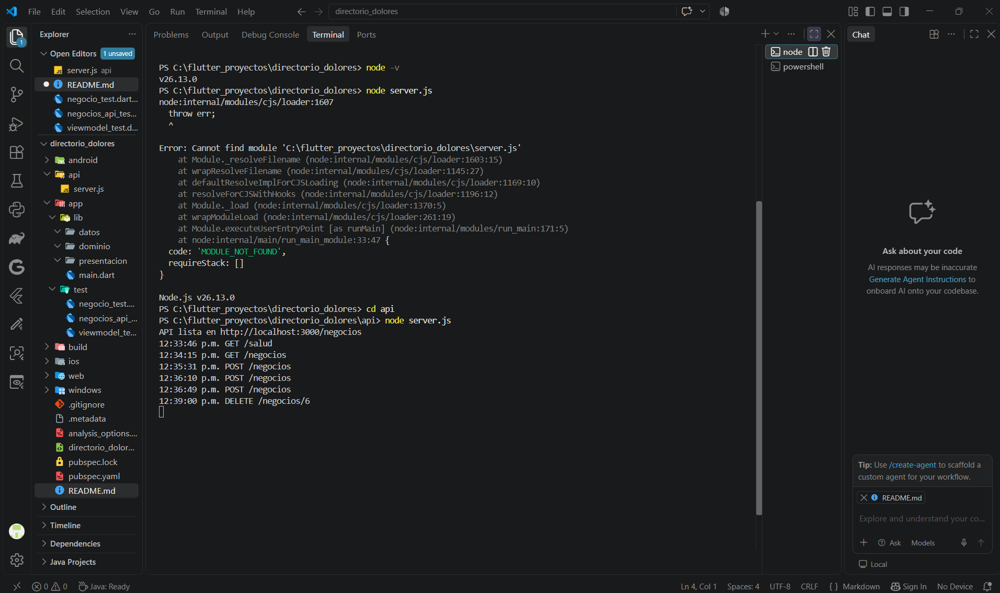
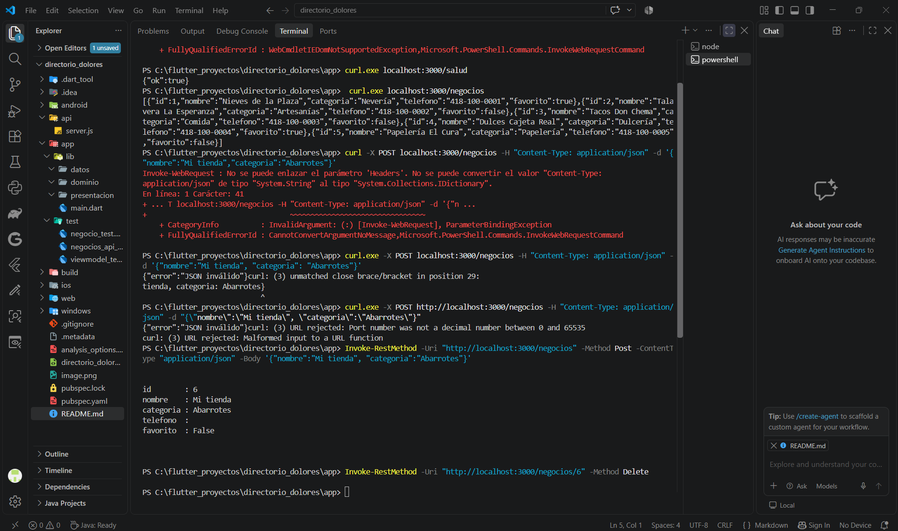

Ronda 2 · El modelo Negocio (Dart puro)
Paso 2.1 · Crear el proyecto Flutter
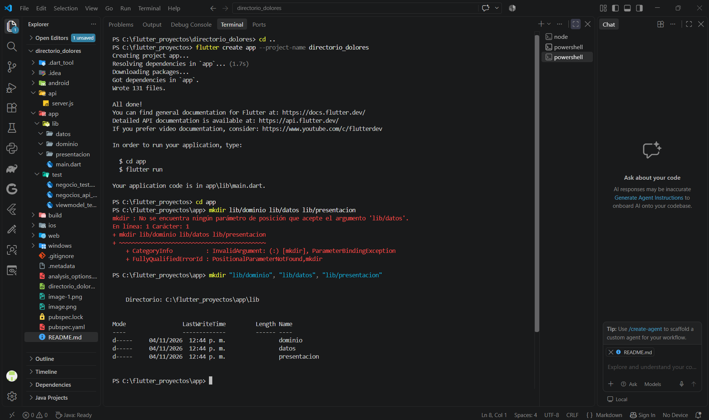
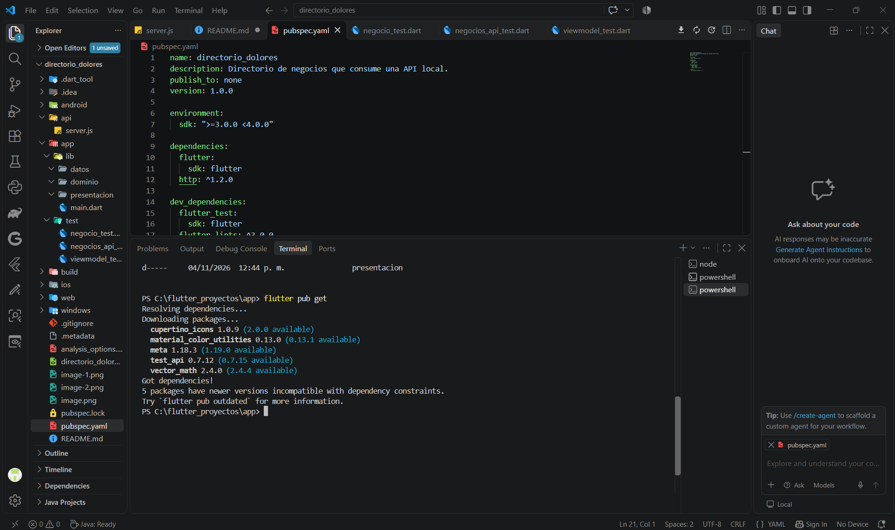

Ciclo 2.2 · Leer todos los campos
ROJO: escribe la prueba (debe FALLAR)
VERDE: el código mínimo para pasar
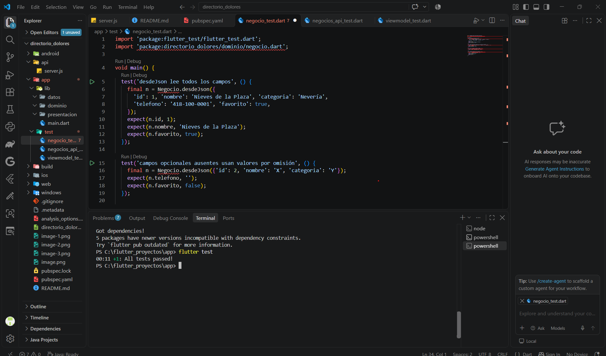
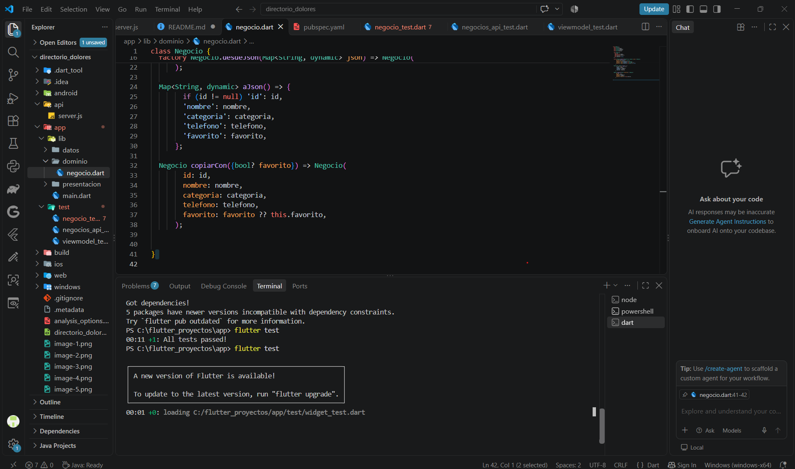

Paso 2.3 · Excepciones con nombre propio

Ronda 3 · El cliente HTTP con MockClient
Ciclo 3.1 · Listar
ROJO: escribe la prueba (debe FALLAR)
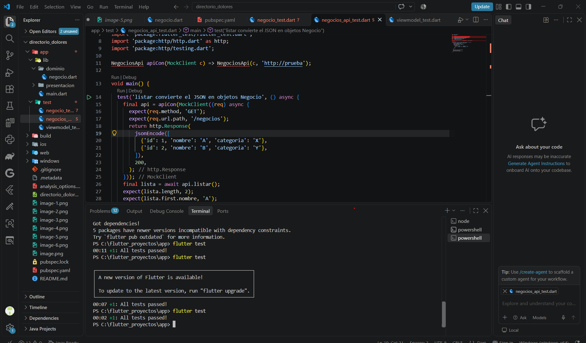
VERDE: el código mínimo para pasar
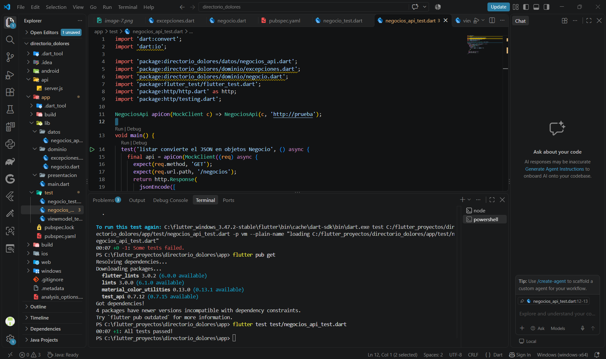

Ciclo 3.2 · Los casos de falla
ROJO: escribe la prueba (debe FALLAR)
VERDE: el código mínimo para pasar
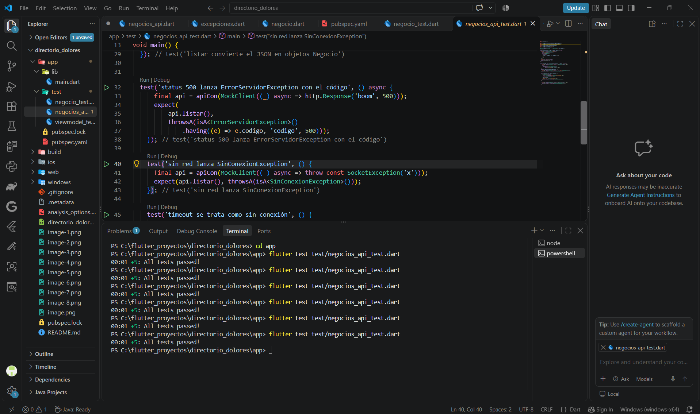

Ciclo 3.3 · Crear, buscar y eliminar
ROJO: escribe la prueba (debe FALLAR)
VERDE: el código mínimo para pasar
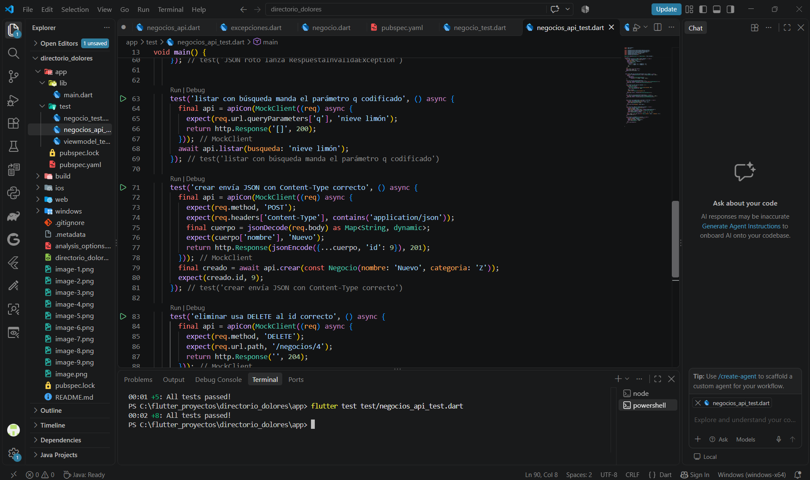

Ronda 4 · Conectar app y API de verdad
Paso 4.1 · Configuración de la URL
Paso 4.2 · Permitir tráfico HTTP en Android

Ronda 5 · El ViewModel y los 5 estados
Ciclo 5.1 · Pruebas de la secuencia de estados
ROJO: escribe la prueba (debe FALLAR)
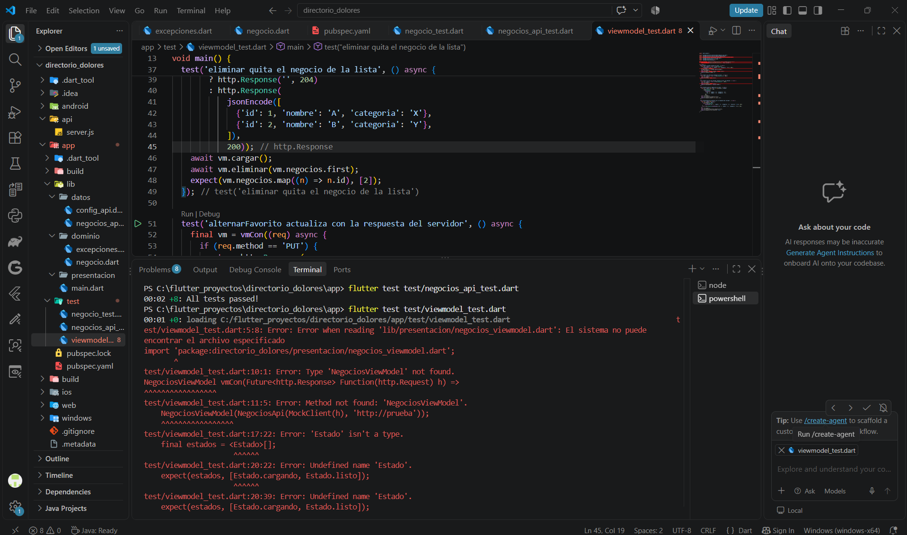
VERDE: el código mínimo para pasar
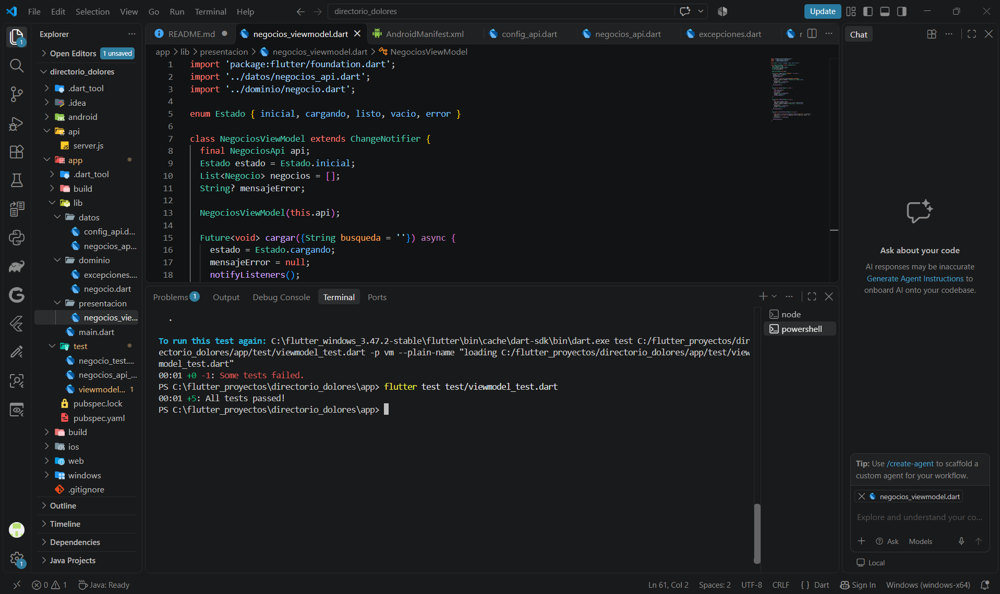

Ronda 6 · La pantalla y la prueba final
Paso 6.1 · La pantalla
Paso 6.2 · Conectar todo
Paso 6.3 · Prueba de fuego (en este orden)
Paso 10.
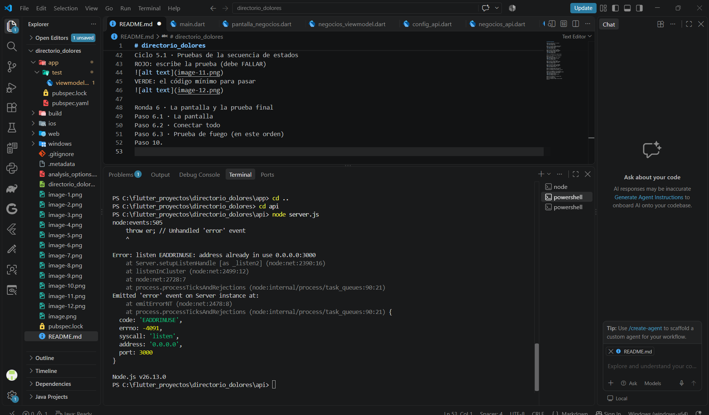
Paso 11.
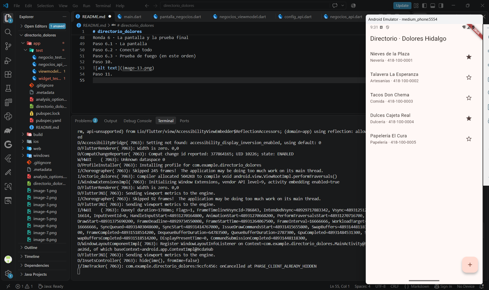
Paso 12.
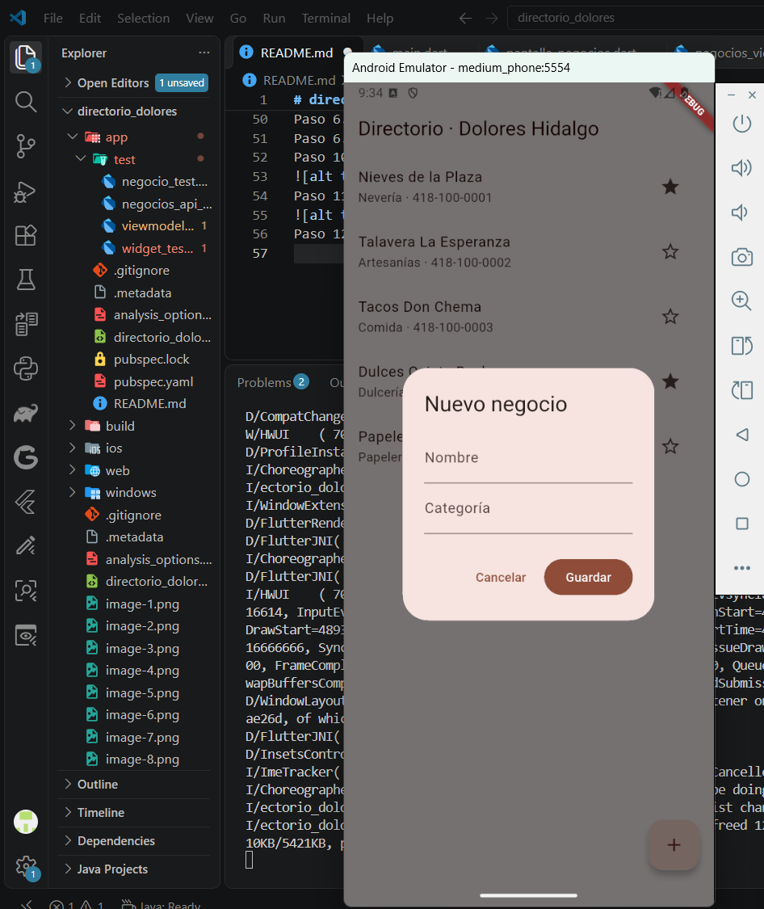
